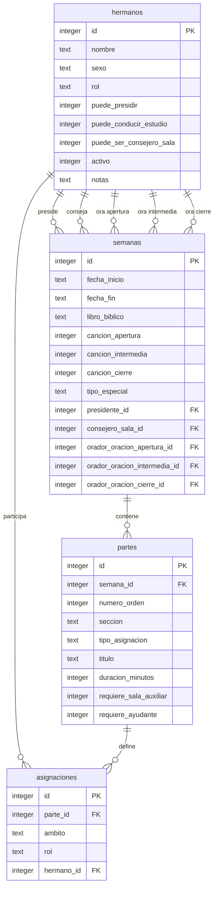
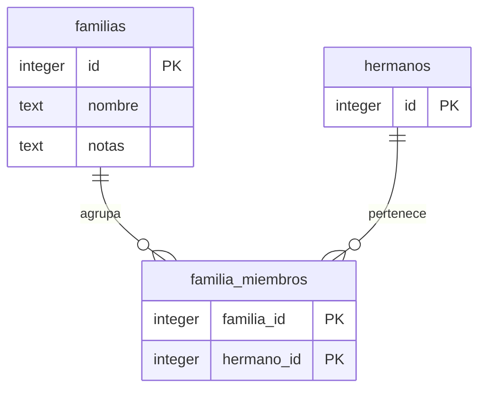

# Schema de la base de datos

- **Motor**: SQLite (archivo local, gestionado por Tauri)
- **Definicion**: `src-tauri/src/db.rs` (migrations en `run_migrations`)
- **PRAGMAs**: `journal_mode=WAL`, `foreign_keys=ON`
- **Tablas**: 6 · **Indices**: 1 unico · **Triggers**: ninguno
- **Convencion**: booleans son `INTEGER` (0/1); fechas son `TEXT` ISO 8601 `YYYY-MM-DD`

## Diagramas ER (Mermaid)

### Núcleo de asignaciones

### Familias

## Tablas y campos

### hermanos

Roster de la congregacion.

| Campo | Tipo | Nulo | Default | Descripcion y valores posibles |
|---|---|---|---|---|
| id | INTEGER | NO | AUTOINCREMENT | PK unica del hermano |
| nombre | TEXT | NO | — | Nombre completo tal como aparece en el roster |
| sexo | TEXT | NO | — | CHECK: `masculino`, `femenino`. Filtra asignaciones "solo varones" |
| rol | TEXT | NO | — | CHECK: `anciano`, `siervo_ministerial`, `publicador`, `estudiante_biblia` |
| puede_presidir | INTEGER | NO | 0 | Flag (0/1). Habilita para presidente de la semana |
| puede_conducir_estudio | INTEGER | NO | 0 | Flag (0/1). Habilita para conductor del estudio biblico |
| puede_ser_consejero_sala | INTEGER | NO | 0 | Flag (0/1). Habilita para consejero de sala auxiliar |
| activo | INTEGER | NO | 1 | Baja logica: 0 oculta del selector sin borrar su historial |
| notas | TEXT | SI | NULL | Notas libres (p. ej. circunstancias especiales) |

### semanas

Una fila por semana del programa (lunes a domingo).

| Campo | Tipo | Nulo | Default | Descripcion y valores posibles |
|---|---|---|---|---|
| id | INTEGER | NO | AUTOINCREMENT | PK unica de la semana |
| fecha_inicio | TEXT | NO | — | Fecha de inicio (lunes), ISO 8601 `YYYY-MM-DD` |
| fecha_fin | TEXT | NO | — | Fecha de fin (domingo), ISO 8601 `YYYY-MM-DD` |
| libro_biblico | TEXT | SI | NULL | Libro biblico en estudio para la seccion Tesoros |
| cancion_apertura | INTEGER | SI | NULL | Numero de cancion de apertura |
| cancion_intermedia | INTEGER | SI | NULL | Numero de cancion intermedia |
| cancion_cierre | INTEGER | SI | NULL | Numero de cancion de cierre |
| tipo_especial | TEXT | NO | 'normal' | CHECK: `normal`, `asamblea`, `conmemoracion`, `visita_superintendente` |
| presidente_id | INTEGER | SI | NULL | FK a `hermanos(id)`. Presidente de la semana |
| consejero_sala_id | INTEGER | SI | NULL | FK a `hermanos(id)`. Consejero de sala auxiliar |
| orador_oracion_apertura_id | INTEGER | SI | NULL | FK a `hermanos(id)`. Ora la oracion de apertura |
| orador_oracion_intermedia_id | INTEGER | SI | NULL | FK a `hermanos(id)`. Ora la oracion intermedia |
| orador_oracion_cierre_id | INTEGER | SI | NULL | FK a `hermanos(id)`. Ora la oracion de cierre |

### partes

Partes del programa (S-140) dentro de una semana.

| Campo | Tipo | Nulo | Default | Descripcion y valores posibles |
|---|---|---|---|---|
| id | INTEGER | NO | AUTOINCREMENT | PK unica del parte |
| semana_id | INTEGER | NO | — | FK a `semanas(id)` ON DELETE CASCADE |
| numero_orden | INTEGER | NO | — | Posicion del parte dentro de la semana |
| seccion | TEXT | NO | — | CHECK: `tesoros`, `mejores_maestros`, `vida_cristiana`, `marco` |
| tipo_asignacion | TEXT | NO | — | Catalogo del enum Rust `TipoAsignacion` (ver tabla abajo). Sin CHECK en DB; validado en Rust |
| titulo | TEXT | SI | NULL | Titulo del parte (p. ej. tema del discurso) |
| duracion_minutos | INTEGER | SI | NULL | Duracion planificada en minutos |
| requiere_sala_auxiliar | INTEGER | NO | 0 | Flag (0/1): el parte se replica en sala auxiliar |
| requiere_ayudante | INTEGER | NO | 0 | Flag (0/1): el parte requiere ademas una asignacion de ayudante |

### asignaciones

Quien cumple cada rol en cada parte.

| Campo | Tipo | Nulo | Default | Descripcion y valores posibles |
|---|---|---|---|---|
| id | INTEGER | NO | AUTOINCREMENT | PK unica de la asignacion |
| parte_id | INTEGER | NO | — | FK a `partes(id)` ON DELETE CASCADE |
| ambito | TEXT | NO | — | CHECK: `auditorio_principal`, `sala_auxiliar` |
| rol | TEXT | NO | — | CHECK: `estudiante`, `ayudante`, `conductor`, `lector` |
| hermano_id | INTEGER | NO | — | FK a `hermanos(id)` sin ON DELETE (NO ACTION): impide borrar un hermano con asignaciones |

### familias

Agrupaciones de hermanos por familia.

| Campo | Tipo | Nulo | Default | Descripcion y valores posibles |
|---|---|---|---|---|
| id | INTEGER | NO | AUTOINCREMENT | PK unica de la familia |
| nombre | TEXT | NO | — | Nombre de la familia |
| notas | TEXT | SI | NULL | Notas libres |

### familia_miembros

Tabla de union muchos-a-mucho entre familias y hermanos.

| Campo | Tipo | Nulo | Default | Descripcion y valores posibles |
|---|---|---|---|---|
| familia_id | INTEGER | NO | — | PK compuesta + FK a `familias(id)` ON DELETE CASCADE |
| hermano_id | INTEGER | NO | — | PK compuesta + FK a `hermanos(id)` ON DELETE CASCADE |

## Relaciones y borrado

- `hermanos` 1:N `semanas` — 5 FK opcionales (presidente, consejero_sala, 3 oradores de oracion); sin ON DELETE
- `semanas` 1:N `partes` — CASCADE: borrar la semana borra sus partes
- `partes` 1:N `asignaciones` — CASCADE: borrar el parte borra sus asignaciones
- `hermanos` 1:N `asignaciones` — sin ON DELETE (NO ACTION)
- `familias` N:M `hermanos` via `familia_miembros` — CASCADE en ambos lados

## Constraints e indices

- PK `AUTOINCREMENT` en las 6 tablas
- UNIQUE INDEX `idx_asignaciones_unique` sobre `(parte_id, ambito, rol)`: solo una asignacion por rol en cada parte y ambito
- PK compuesta `(familia_id, hermano_id)` en `familia_miembros`: un hermano no se repite en la misma familia
- CHECK constraints en `hermanos.sexo`, `hermanos.rol`, `semanas.tipo_especial`, `partes.seccion`, `asignaciones.ambito`, `asignaciones.rol`
- `PRAGMA foreign_keys=ON` exige que toda FK apunte a una fila existente

## Catalogo de tipo_asignacion

Validado en Rust (`src-tauri/src/models.rs`, enum `TipoAsignacion` en snake_case), no por CHECK en la DB.

| Valor | Seccion | Sala auxiliar | Ayudante | Solo varones | Solo no estudiante |
|---|---|---|---|---|---|
| discurso_no_estudiante | tesoros | no | no | no | si |
| busquemos_perlas | tesoros | no | no | no | si |
| lectura_biblia | tesoros | si | no | si | no |
| empiece_conversaciones | mejores_maestros | si | si | no | no |
| haga_revisitas | mejores_maestros | si | si | no | no |
| haga_discipulos | mejores_maestros | si | si | no | no |
| explique_creencias_discurso | mejores_maestros | si | no | si | no |
| explique_creencias_escenificacion | mejores_maestros | si | si | no | no |
| discurso_estudiante | mejores_maestros | si | no | si | no |
| que_dirias | mejores_maestros | si | no | no | si |
| analisis_auditorio | vida_cristiana | no | no | no | si |
| necesidades_congregacion | vida_cristiana | no | no | no | si |
| estudio_biblico | vida_cristiana | no | no | no | si |
| oracion | marco | no | no | no | no |
| cancion | marco | no | no | no | no |
| introduccion | marco | no | no | no | no |
| conclusion | marco | no | no | no | no |

> Nota: `partes.seccion` tiene CHECK con 4 valores (`tesoros`, `mejores_maestros`, `vida_cristiana`, `marco`), pero el modelo Rust en algunos comentarios solo nombra 3; el valor `marco` es valido y usado por `oracion`, `cancion`, `introduccion` y `conclusion`.
